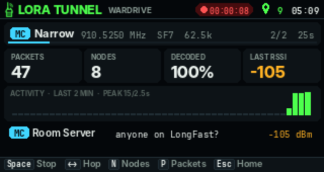
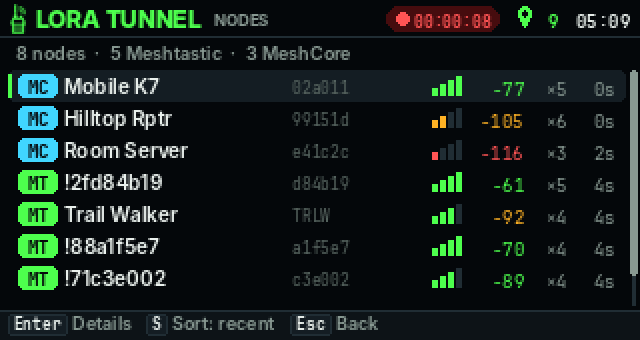
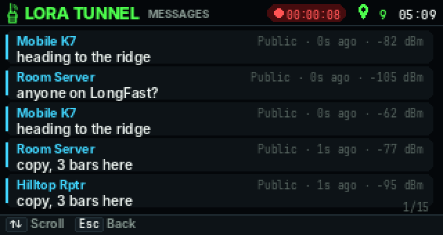
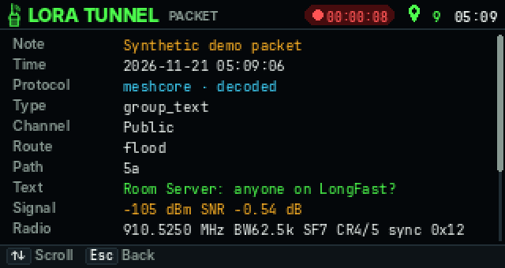
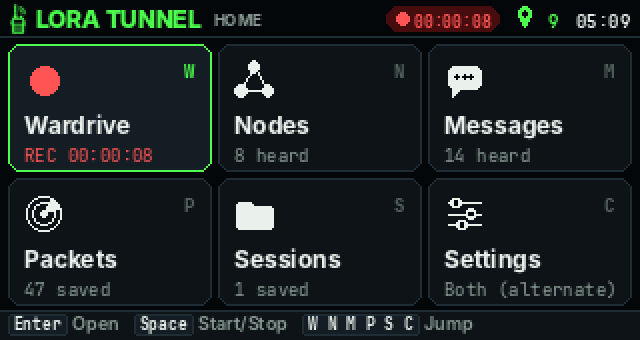
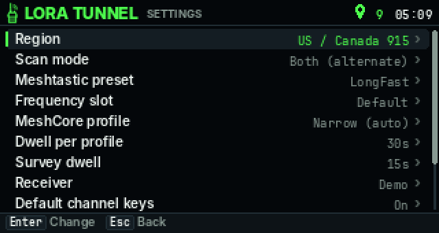

# LORA Tunnel for M5Stack CardputerZero

LORA Tunnel turns the **M5Stack CardputerZero** and the **Cap LoRa-1262 (U214)** into a standalone LoRa mesh wardriver. It listens for Meshtastic and MeshCore traffic, decrypts the channels you hold keys for, tracks every node it hears, and saves each frame with its raw bytes, exact radio settings and your GPS position.

It runs as an APPLaunch app from the CardputerZero store or as a `.deb` you install yourself. It's the CardputerZero member of the LORA Tunnel family, next to the ESP32 firmware for the Cardputer ADV and Heltec V4 in this repository.

| Wardrive | Nodes | Messages |
| --- | --- | --- |
|  |  |  |
| **Packet detail** | **Home** | **Settings** |
|  |  |  |

The screenshots are rendered from the app's own drawing code with its synthetic demo receiver. They aren't photos of real traffic.

## What it does

- **Same channel plan as Kismet's LoRaPipe.** All nine Meshtastic presets at the default slot for each region, explicit slots, and Kismet's MeshCore regional presets. Channel IDs use Kismet's names (`meshtastic-US-LONG_FAST`, `meshcore-US-NARROW`). Frequencies are tested against Kismet's channel reference.
- **Four scan modes.** Meshtastic only, MeshCore only, both alternating, or **Survey**, which hops every preset and MeshCore profile in your region so you can find what the local community actually uses. Dwell time is adjustable from 5 to 600 seconds. You can hop by hand with ← →.
- **Decoding.** Meshtastic NodeInfo, position, telemetry and text on the default channels for every preset, plus private channels you add. MeshCore signed adverts (Ed25519-verified), public-channel and hashtag-channel group text, and private channel secrets. Frames it can't decode are still saved.
- **Live views.** Packet counts, node count, decode rate, last RSSI and a two-minute activity graph colored by signal. There are sortable node lists, per-node details with distance and bearing to a node's claimed position, a feed of heard channel messages, and a per-packet inspector with a hex dump.
- **Logs and exports.** Each session folder in `~/LoRaTunnel/sessions/` holds `observations.jsonl`, `capture.sqlite3` and `lora.pcap` (LoRaTAP, link type 270, which opens in Wireshark). One key exports `nodes.csv`, `packets.csv` and a Google Earth `nodes.kml`.
- **Honest location data.** Your receiver fix, from gpsd or the cap's GNSS UART, is stored separately from positions that nodes advertise about themselves. A stale fix is never written as a position.
- **Receivers.** The Cap LoRa-1262 is the default. A **LoRaPipe** USB radio (RXLOG serial CLI) also works, as does a synthetic demo receiver for trying the app without hardware.

Receive only: this version never transmits. Meshtastic/MeshCore messaging and the Recon counter-surveillance mode are the next step.

## Controls

The CardputerZero keyboard works like the Cardputer ADV build: `;` `.` `,` `/` are Up, Down, Left and Right, and `` ` `` is Escape. Real arrow keys work too.

| Key | Action |
| --- | --- |
| `Space` | Start or stop capture, from Home or Wardrive |
| `Enter` / `Esc` | Open / back |
| `W` `N` `M` `P` `S` `C` | Jump to Wardrive, Nodes, Messages, Packets, Sessions, Settings |
| `←` `→` | Hop to the previous or next profile while capturing |
| `S` on Nodes | Change the sort order (recent, signal, count) |
| `E` / `D` on a session | Export / delete |

On first launch the app asks for your LoRa region. LoRa stays off until a region is chosen.

## Install

From the store: open the CardputerZero App Store and enter share code **LORA**, once the listing is live.

By hand: download `lora-tunnel_<version>_all.deb` from the latest CI run or release, then:

```sh
scp lora-tunnel_1.0.0_all.deb pi@<device-ip>:/tmp/
ssh pi@<device-ip> "sudo apt install -y /tmp/lora-tunnel_1.0.0_all.deb"
```

Power the device off before fitting or removing the cap, because the cap bus isn't hot-pluggable. The package adds login users to the `video input spi gpio i2c dialout` groups and installs a `tmpfiles.d` rule so the `gpio` group can switch the cap's 5 V rail. Log out and back in, or reboot, once after the first install so the group changes take effect. The app runs as your normal user and ships no root service.

## Settings and channel keys

Settings live in `~/.config/lora-tunnel/config.json` (mode 0600) and can all be changed on the device. To decode a private Meshtastic channel, go to **Settings → Meshtastic keys → A**, then type the exact channel name and its base64 key from the Meshtastic app or channel URL. MeshCore private channels take a 16- or 32-byte base64 secret, and hashtag channels (`#name`) need only the name. Key values are never shown on screen or written to logs.

## Hardware notes

The Cap LoRa-1262 is driven directly: SX1262 on SPI0 CE1 (`/dev/spidev0.1`), BUSY GPIO22, DIO1 GPIO23, RESET GPIO26, the 3.0 V TCXO on DIO3, and the PI4IOE5V6408 RF switch at I²C1 0x43. GNSS is read from `/dev/ttyS0` at 115200 baud, or through gpsd when it's running. The cap covers 868 to 923 MHz, so profiles outside that band (such as `meshcore-US-SOCAL` at 927.875 MHz) are listed as out of band rather than tuned.

## Build, test and publish

```sh
cd cardputer-zero
python3 -m pytest -q tests               # host tests, no hardware needed
python3 -m lora_tunnel_zero --demo --png /tmp/frame.png   # run the UI on a desktop
python3 tools/render_screens.py           # regenerate screenshots/
python3 tools/build_deb.py                # build/lora-tunnel_<version>_all.deb
```

To publish to the CardputerZero store with M5Stack's [czdev](https://github.com/CardputerZero/AppBuilder):

```sh
czdev login
cd cardputer-zero
czdev publish --deb build/lora-tunnel_1.0.0_all.deb
```

The store metadata is in `app-builder.json`. A first release is reviewed by hand: post a short video of the app running on a real CardputerZero in the publish PR, and a maintainer merges it. Later versions merge automatically.

## Verification status

The radio driver, decoder, LoRaTAP writer, session storage, capture engine, exports, settings and every screen are covered by host tests with mocked hardware and the synthetic receiver. The package passes the store's own install-path and metadata policy scripts. Still to be checked on a physical CardputerZero with the cap: a cold start, reception from known Meshtastic and MeshCore nodes, an outdoor GNSS fix, and a long capture with a stop and restart.

## License

MIT (see `LICENSE`). The bundled Inter and JetBrains Mono fonts are under the SIL Open Font License; their notices are in `lora_tunnel_zero/assets/fonts/`.
